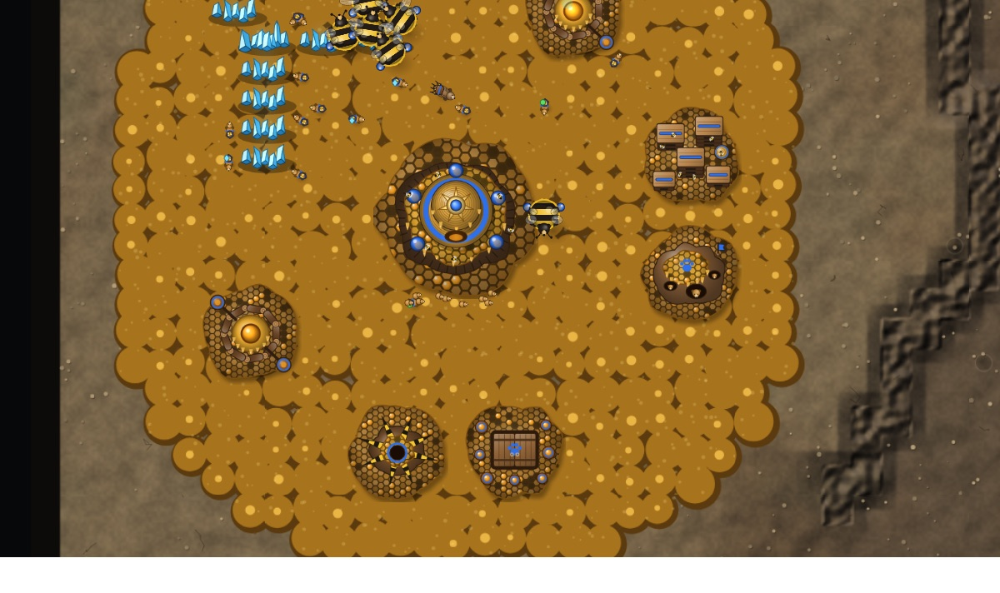
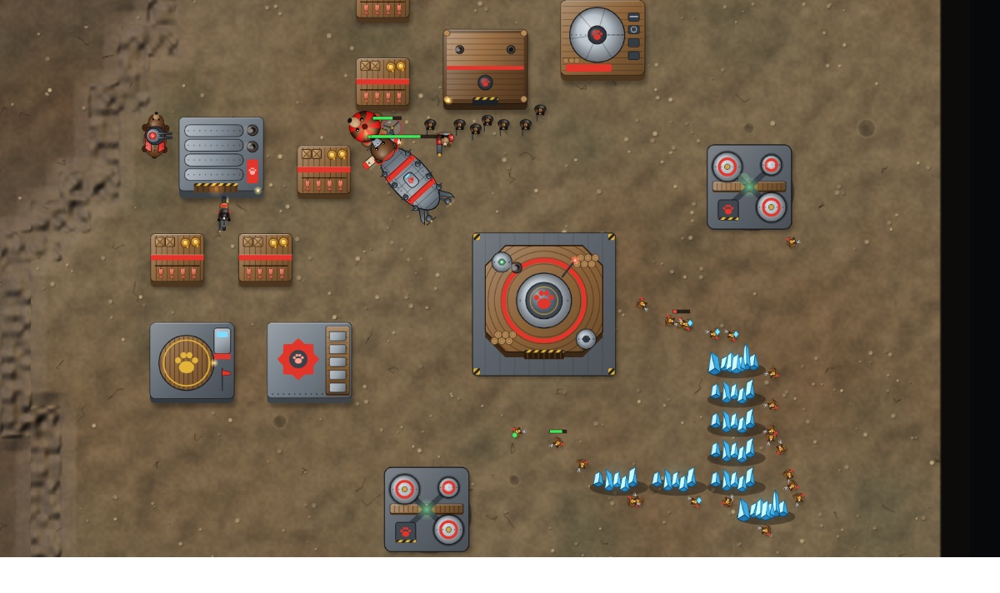
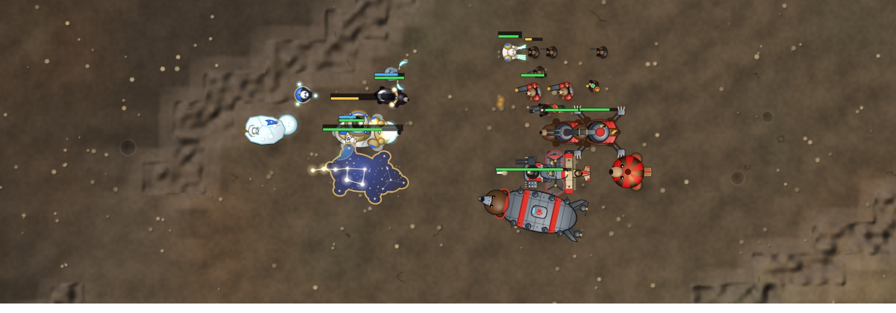

# Bear War

**An open-source real-time strategy game for desktop and mobile browsers.** Three clans of bears, skirmish against computer opponents (works offline), and online multiplayer. Play in a browser with nothing to install, or install it as an app.

Bear War follows the classic competitive RTS formula: harvest two resources, manage supply, climb a tech tree, scout through fog of war, fight for high ground and expansions, and out-macro and out-micro your opponent. Every clan, bear, name, graphic and sound in the game is original. Graphics are drawn procedurally in code and audio is synthesized at runtime, so **the project ships no third-party art, audio, or fonts**.

<p align="center">
  
  
  
</p>

> Bear War is an independent project, inspired by the gameplay of classic RTS games such as StarCraft. It is not affiliated with, endorsed by, or connected to Blizzard Entertainment. StarCraft is a trademark of Blizzard Entertainment, Inc. No Blizzard assets, names, code or data are used.

---

## Features

- **Three asymmetric clans**, from 8 px cubs to Cave Titans that fill a ramp
  - **Ironpaw**: hard-working brown bears of the timber country. Hardhats construct buildings and must stay until they're finished; they can repair machines. Damaged buildings burn down. Infantry can garrison Bunkers. Rangers with Honey Rush, Grizzlies, Honey Medics, Blaze Riders that hop off to fight as Blaze Brutes, Sappers that dig in and wait, Kodiaks that brace into artillery, Trackers that lock on, Hoverbears that anchor over a zone, Bearloon drop balloons and the Iron Mama flagship with its Grand Cannon.
  - **Honey Horde**: feral bears living alongside giant bees. Hives raise cubs that grow into any bear, and Foragers are used up to grow structures on spreading honeycomb. Every Horde bear heals over time. Scrappers grow into Buzzbombs, Stingers into Bombardiers (Scalding Honey) or Burrowers (hibernate and erupt spines in a line), Den Mothers release Wild Cubs, Longtongues yank enemies and blind gunners with pollen, and Bumblebears become transports once Cargo Pouch is researched.
  - **Starborn**: mystic polar, spirit and moon bears. Snowcubs call buildings down from the sky and are free immediately. Structures need a Star Totem's glow. Every bear wears a regenerating aurora shield. Spirit Bears, Moon Bears with Moonstep, Glacier Bears with Spirit Walk, Panda Sages with Starfall, hidden Shadowpaws, Seers with a Sunlance, Snowballers, Polar Colossi and the Great Bear constellation.
- **Classic macro and micro**
  - Mining with saturation and gas extraction, supply, production queues, rally points (rallying to minerals makes new workers mine automatically), and weapon/armor upgrades.
  - Royal Jelly, Moonlight Haste, Big Sniff.
  - High-ground vision, hiding and detection, burrowing, mode switches, splash and line damage, bonus damage vs. light/armored, shields, energy and spells.
  - **Drops and garrisons**: transports carry 8 cargo slots of ground units (small units take 1, medium 2, large 4) over cliffs and water. Infantry inside a Bunker fire out with +1 range and can't be targeted.
- **Controls designed for both touch and mouse/keyboard**: one-finger pan, pinch zoom, tap-to-command, long-press box select, quick-select army and idle workers, control groups. On desktop you get full hotkeys, shift-queuing, edge scrolling and the usual mouse controls.
- **Skirmish vs AI** at four difficulty levels (Easy to Brutal), on 1v1, 2v2 or free-for-all maps. The AI scouts, expands, techs, builds counters, attacks in waves, defends, digs in, anchors and casts spells.
- **Online multiplayer** using deterministic lockstep networking. A tiny relay server handles lobbies, invite links, chat, lag pausing, disconnect handling and desync detection.
- **Works offline / installable (PWA).** After the first visit everything is cached.
- **Replays.** Save any game from the end screen or pause menu and watch it later with full vision or one team's vision, at 0.5x to 32x speed or on Auto, which fast-forwards quiet stretches and slows down for fights. Replays work because the simulation is deterministic: a replay is just the seed plus the command log.
- **Three maps** (Twin Craters, Frostline, Four Corners) with symmetric layouts, ramps, cliffs, chokes and expansions, plus a small DSL for making more.

## Quick start

Requires **Node.js 22.18+** (the server runs TypeScript directly).

```bash
npm install
```

```bash
npm run dev
```

Open http://localhost:5173 to play. For multiplayer while developing, also run the relay server in a second terminal:

```bash
npm run dev:server
```

To run the production build (the server serves the game and the multiplayer lobby on one port, default 8787):

```bash
npm run build
```

```bash
npm start
```

Developer shortcut: `http://localhost:5173/?quick&race=horde&vs=starborn&ai=hard&map=frostline` jumps straight into a skirmish, and `?attract` runs the muted AI-vs-AI spectator demo shown on the Local Desktop home page.

## How to play

Destroy every enemy structure. Workers mine **minerals** and **gas** (gas needs a refinery-type building on a geyser); two to three workers per mineral field is ideal. Units cost **supply**, so stock up ahead of time (Larders, Bumblebears, Star Totems).

| Touch | |
|---|---|
| Tap own unit/building | Select (double-tap: all of that type on screen) |
| Tap ground / enemy / minerals with units selected | Move / attack / gather |
| Tap own transport or Bunker with units selected | Load them in (the transport's **Unload** button drops them) |
| One-finger drag | Pan the camera |
| Pinch | Zoom |
| Long-press + drag, or the ▢ button | Box select |
| Long-press a command button | Show details & costs |
| Group buttons 1-5 | Tap to select, long-press to assign |
| Army / worker buttons | Select whole army / idle worker (long-press: all idle workers) |
| Building placement | Drag the ghost, then tap **✓ Build** |

| Mouse & keyboard | |
|---|---|
| Left-click / drag | Select / box select (Shift adds, Ctrl or double-click selects all of a type) |
| Right-click | Smart command: move, attack, gather, repair, load into a transport or Bunker, set rally (Shift queues) |
| Command card | The character on each button. Keys follow the left-hand block, so they match your keyboard layout (QWERTY: `Q W E R` / `A S D F` / `Z X C V`) |
| Transport | Load and unload are on the command card (click a passenger's icon to drop just that unit) |
| Ctrl+`1-9` / `1-9` | Set / recall control group (press twice to jump to it) |
| `F1` / `F2` | Idle worker / select army |
| `Tab`, `Space`, `Backspace` | Cycle subgroup, jump to last alert, cycle bases |
| Arrow keys, screen edges, middle-drag, wheel | Scroll and zoom |
| `Esc` | Cancel targeting / placement, or the last queued item |

The full stats for every unit, structure and upgrade are in **[docs/UNITS.md](docs/UNITS.md)**.

## Multiplayer

Online games use **deterministic lockstep** networking. The server never simulates the game. It collects each player's commands, groups them into 100 ms *turns*, and broadcasts every turn to every client. Each client runs the identical simulation, which keeps bandwidth tiny (a few hundred bytes per second) and makes cheating by editing game state impossible. Clients exchange state hashes so any desync is detected.

Because every client must run *exactly* the same simulation, the build embeds a fingerprint of the simulation source (`src/game`). The server computes the same fingerprint from its own copy and turns away clients that differ, so a browser tab left open across a deploy gets a "please reload" message instead of a desynced game. Deploy the client and the server from the same commit.

**Hosting a server.** `npm run build && npm start` serves the game and the lobby (WebSocket at `/ws`) on `PORT` (default 8787). Any Node host works: a VPS, Fly.io, Render, Railway, or a Raspberry Pi. A [Dockerfile](Dockerfile) is included:

```bash
docker build -t bear-war .
```

```bash
docker run -p 8787:8787 bear-war
```

**Static hosting + separate server.** The client is fully static and can be hosted anywhere, such as GitHub Pages. Point it at your server at build time with `VITE_SERVER_URL=wss://your-server.example/ws npm run build`. Players can also type a server address in the Multiplayer screen, or open an invite link with `?server=...`.

Lobby features:
- Public game list, or 5-letter join codes and shareable invite links.
- Clan, colour and team selection, and AI slots in online games.
- Chat, kicking, host migration.
- Automatic pausing when a player lags.
- **Automatic reconnection** when a phone drops its connection mid-game (the game waits up to 45 s, then resumes exactly where the player left off).

## Development

```text
src/
  game/        deterministic simulation (no DOM): data, map, pathfinding, systems, AI, commands
    data/      bears, structures, research and abilities for all clans (pure data)
    systems/   combat, movement, units (orders), structures (production), vision, honeycomb, abilities
    ai/        computer opponent (runs inside the simulation)
    map/       map format, symmetric map builder DSL, map definitions
  render/      canvas renderer, procedural terrain, sprites (art/*), effects, minimap
  ui/          HUD, command card, selection, input (mouse/keyboard/touch)
  audio/       Web Audio synthesizer and generative music
  net/         lockstep sessions, WebSocket client, protocol, room/turn clock
  app/         menus, lobby, game screen
server/        Node relay + static file server
scripts/       dev tools (see below)
tests/         vitest suites
```

| Command | What it does |
|---|---|
| `npm run dev` / `npm run dev:server` | Dev client with hot reload / multiplayer server with auto-restart |
| `npm test` | Unit tests: data integrity, deterministic math, determinism, pathfinding, maps, abilities, transports, lobby/turn protocol |
| `npm run typecheck` | TypeScript type check (client, server, scripts, tests) |
| `npm run simtest -- 24000 7 horde starborn hard` | Headless AI-vs-AI game (`VERBOSE=1` for a timeline, `MAP=frostline` for another map) |
| `node scripts/battle.ts` | Balance lab: equal-cost armies fight on an open arena |
| `node scripts/mapview.ts frostline` | Print a map as ASCII while designing it |
| `node scripts/gen-docs.ts` | Regenerate [docs/UNITS.md](docs/UNITS.md) from the data |
| `npm run icons` | Regenerate the PNG app icons (procedurally) |
| `/gallery.html` (dev server) | Sprite gallery of every unit and structure |

**The simulation must stay deterministic.** Everything in `src/game` runs identically on every client. No `Math.random`, `Math.sin/cos/atan2/pow/hypot/...`, or wall-clock time is allowed there; use `src/game/math.ts` and the seeded RNG instead. A test enforces this. See [docs/ARCHITECTURE.md](docs/ARCHITECTURE.md) for how the lockstep model, pathfinding, fog of war and the AI work, and [CONTRIBUTING.md](CONTRIBUTING.md) before sending changes.

## Assets & licensing

- **Code:** MIT (see [LICENSE](LICENSE)).
- **Graphics:** every sprite, terrain texture, icon and effect is generated by code in `src/render` (and `scripts/make-icons.ts` for the app icons). They're covered by the same MIT license.
- **Audio:** all sound effects and music are synthesized at runtime by `src/audio/audio.ts`. No audio files exist.
- **Spoken alerts** are optional and use the browser's built-in speech synthesis. No voice recordings are shipped.
- **Fonts:** the system UI font stack. No font files are bundled.
- **Dependencies:**
  - Runtime: [`ws`](https://github.com/websockets/ws) (MIT, server only).
  - Build/dev tools: [Vite](https://vite.dev) (MIT), [TypeScript](https://www.typescriptlang.org) (Apache-2.0), and [Vitest](https://vitest.dev) (MIT). Their transitive dependencies are MIT, ISC, BSD and MPL-2.0 (`lightningcss`, build-time only). None are bundled into the game except what Vite emits from this repository's own code.
- **Names:** all clan, unit, structure, ability and map names are original to this project.

Contributions must keep this property: no third-party assets unless they're CC0/public domain and recorded in this section.

## Roadmap

- Observer slots in online lobbies, and rejoining after a full page reload (today: reconnects while the page stays open).
- Peer-to-peer (WebRTC) games without a relay server.
- More maps and a map editor. Lifting off buildings.
- Teach the computer opponent drops and Bunker play.
- Continued balance tuning (`scripts/battle.ts` and AI-vs-AI runs are the starting points).

## License

[MIT](LICENSE) © Bear War contributors
