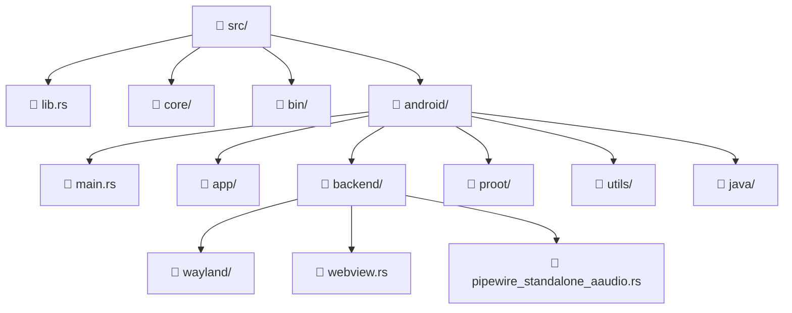
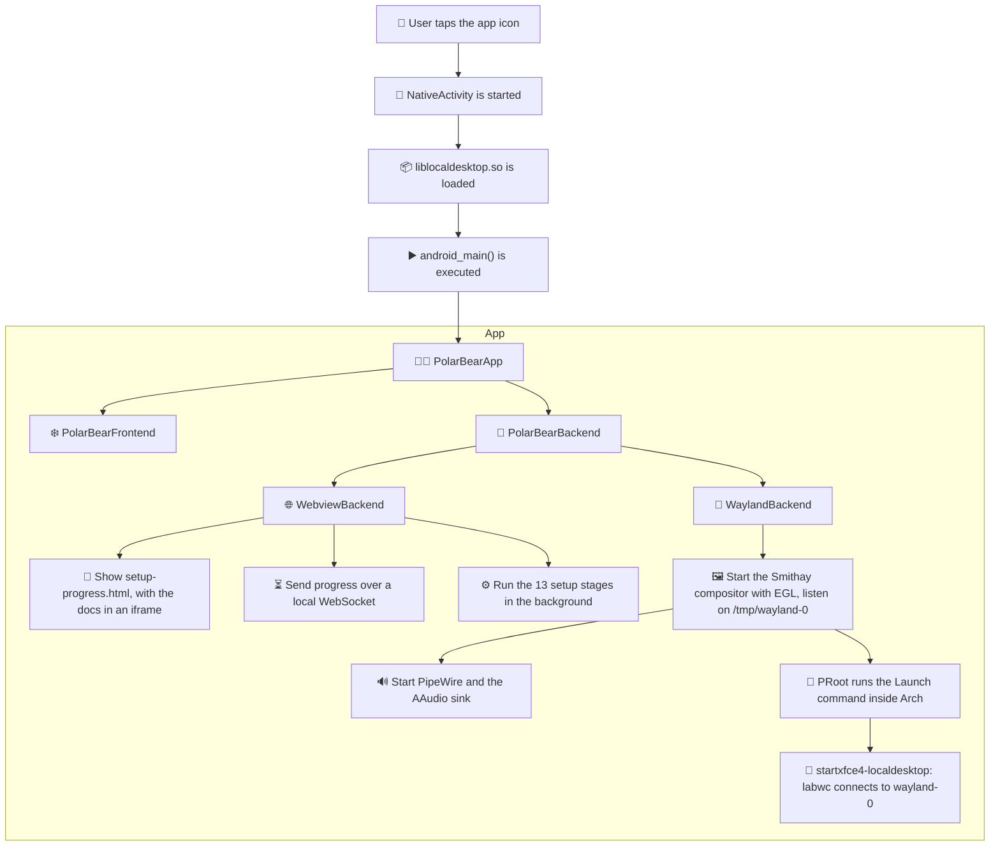

The whole project (the app, its patches, this website and the editor extension) lives in one repository. This page is a map, so you know where to look.

## Top level structure

The `src` folder is the most important one. It contains all the Rust code, and the few Java classes that Android needs.

Other important files and folders:

- `manifest.yaml`: The Android manifest and build config for xbuild: package name, permissions, activities, services and assets. **The package name comes from here**, so don't hard-code it anywhere else.
- `assets`: The app icon, the HTML pages for the installer and the "Device Unsupported" page, and the prebuilt native libraries (PRoot, libxkbcommon, PipeWire, the guest's GPU drivers) for the APK to pick up.
- `patches`: Our patched copies of upstream projects, like `smithay`, `winit`, `xbuild` and PRoot. These let us fix things without waiting, and we send the good changes back upstream. See [Patching dependencies](/docs/developer/patching-dependencies).
- `scripts`: The 16 KB ELF alignment check, the [Termux build script](/docs/developer/building-the-app#can-i-build-on-termux), and the PipeWire AAudio sink build.
- `build.rs`: Tells Cargo where the prebuilt native libraries are, so the crate can link against them.
- `Makefile`, `Dockerfile`: Build shortcuts, see [Building the app](/docs/developer/building-the-app).
- `docs/architecture.md`: A short architecture overview that goes into the [PDF manuals](/docs/developer/building-the-offline-manuals).
- `gh-pages`: This website (Docusaurus), and the Bear War game on the home page.
- `vscode-extension`: The [Local Desktop Dev extension](/docs/developer/using-the-maintainer-tools), and its MCP server and CLI.
- `target`: Your build artifacts go here.

## Source code structure

- `lib.rs`: This file behaves more like a contact book. You only register the modules here, no actual logic goes here.
- `core/config.rs`: Default values: where the Arch filesystem lives, the rootfs download URL, and the default **Check**, **Install** and **Launch** commands.
- `android/main.rs`: Did you see that `#[no_mangle] fn android_main` function? Android apps do not have a `main` function, instead:
  - When you open an Android app (by tapping the app icon), Android launches an activity.
  - An activity is a Java class that extends `android.app.Activity`. Most of Local Desktop is written in Rust, so we register a special `NativeActivity`.
  - The `NativeActivity` loads the `android_main` inside `liblocaldesktop.so` (the library into which all of our Rust code is compiled). That's why we need the `#[no_mangle]` annotation, to prevent the Rust compiler from changing the function name.

So `android/main.rs` is the genesis of all the spaghetti code. In case you get lost, just put a breakpoint at the beginning of this function and follow the execution flow. It also sets up logging and Sentry, and keeps the screen on.

### `android/`

| Path | What it does |
|---|---|
| `app/build.rs` | Builds `PolarBearApp` and decides between the installer and the desktop |
| `app/run.rs` | The winit event loop: resume, suspend, resize, and user events |
| `backend/webview.rs` | The installer and "Device Unsupported" pages, and the WebSocket that sends them progress |
| `backend/wayland/compositor.rs` | The Smithay compositor state: surfaces, seats, the clipboard, xdg-shell |
| `backend/wayland/event_centralizer.rs` | Turns winit events (touch, mouse, keys) into one input type, and decides between tap, scroll, long press and drag |
| `backend/wayland/event_handler.rs` | Sends that input to the Wayland clients, and draws frames |
| `backend/wayland/winit_backend.rs` | EGL setup and rendering to the Android window |
| `backend/wayland/hardware_buffer.rs` | Fast `AHardwareBuffer` uploads for `wl_shm` clients |
| `backend/wayland/frame_clock.rs`, `watcher.rs` | The vsync-driven frame loop, and the thread that wakes it when a client writes |
| `backend/wayland/output_state.rs` | Writes the screen size and scale to `/tmp/localdesktop-output` for the guest |
| `backend/wayland/keymap.rs` | Maps winit's physical keys to Linux scan codes |
| `backend/wayland/input.rs` | The winit input types, wrapped for Smithay |
| `backend/wayland/bind.rs` | Creates the `wayland-0` socket in the guest's `/tmp` |
| `backend/pipewire_standalone_aaudio.rs` | Starts and watches PipeWire, WirePlumber and pipewire-pulse on the Android side |
| `proot/setup.rs` | The 13 setup stages, see [Understanding the architecture](/docs/developer/understanding-the-architecture#the-first-run) |
| `proot/process.rs` | Builds the `proot` command line: binds, environment, user |
| `proot/launch.rs` | Runs the **Launch** command once the compositor is ready |
| `accessibility.rs` | The bridge to the keyboard accessibility service |
| `clipboard.rs` | Shares text between the Android clipboard and the Linux one (with `localdesktop-clipboard` in the guest) |
| `external_display.rs` | The bridge to `ExternalDisplay.java`, for monitors |
| `utils/settings.rs` | Reads the settings saved by `SettingsActivity` |
| `utils/application_context.rs` | Paths, permissions and other facts about the app, read once at start |
| `utils/ndk.rs` | Screen density and other values from Android |

### `android/java/`

Some things are much easier in Java than through JNI, so a few small classes live in `src/android/java/io/github/localdesktop/`:

| Class | What it does |
|---|---|
| `SettingsActivity` | The settings page in App info |
| `PhoneKeyboard` | Shows and hides the Android keyboard, and resizes the desktop above it |
| `KeyboardAccessibilityService`, `KeyboardShortcutsPrompt` | The [physical keyboard service](/docs/user/using-a-physical-keyboard), and the prompt that suggests it |
| `ExternalDisplay`, `TrackpadControls` | The desktop on a monitor, and the trackpad on the phone |

The Gradle build (xbuild) compiles them. The `cargo run` builder uses the prebuilt `src/android/dex/classes.dex` instead, see its `README.md`.

### `bin/`

| File | What it does |
|---|---|
| `build_apk.rs` | The small APK builder behind `cargo run`, for building on Termux |
| `build_docs.rs` | Builds the [PDF manuals](/docs/developer/building-the-offline-manuals) |
| `download_sdk.rs` | Downloads the Android SDK build-tools, for building on Termux |
| `localdesktop_pipewire_aaudio_sink.rs` | The PipeWire sink that plays through AAudio |

## Execution flow

The names `PolarBearApp`, `PolarBearFrontend` and `PolarBearBackend` are from the project's first name, Polar Bear 🐻‍❄️, which is also why the app icon is a bear.
